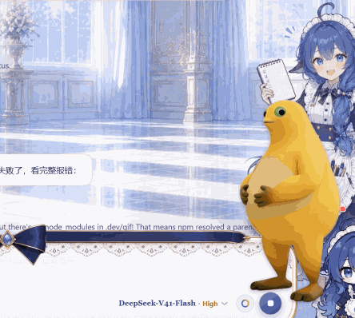

# Blob Pet

A draggable, transparent, always-on-top **desktop pet for Windows** that also reads your sites for you.

One sprite, two windows, no tray icon, no background service, no telemetry. It talks to the sites you configure and to nothing else.



*Sits on top of everything, drags anywhere, and passes clicks through its transparent corners.*

---

## New in 2.0: it now has a job

Version 1 was just a pet. Version 2 makes it a **news filter that lives on your desktop**:

- **Polls the sites you choose** (default: four China Agricultural University pages) on an interval.
- **Keeps only what matches your topics** — competitions, internships/jobs, AI, graduate admissions, campus notices — and drops everything else.
- **Summarises each hit in one or two extractive sentences**, plus the deadline and the contact address pulled out as tags.
- **Shows the digest in a panel** beside the pet: topic chips, title, summary, date, source, and a link straight to the original page.
- **Works with zero API keys.** An OpenAI-compatible endpoint can be configured later to replace the rule summariser; if that call fails it silently falls back.
- **Paste any URL** into the panel to fetch, summarise and pin that page right now.

Everything runs in the main process; renderers only ever receive prepared JSON. See [README.zh-CN.md](README.zh-CN.md) for the full guide (站点配置、筛选规则、摘要原理、打包) — it is the primary document.

## What it does

- **Drag it anywhere** with the left mouse button — across the desktop, across monitors.
- **Remembers where you left it** (`%APPDATA%\Blob Pet\pet-state.json`), restored on the next launch.
- **Transparent pixels are click-through** — the empty corners around the artwork do not swallow clicks meant for the desktop or the window underneath.
- **Never steals focus.** The window is created with `focusable: false` (`WS_EX_NOACTIVATE` on Windows), so clicking the pet does not pull focus away from whatever you are typing in.
- **Click it to open the digest**, right-click for `查看摘要 / 立即刷新 / 退出桌宠`.
- **Sits still while you hold it.** It floats gently when idle and never changes size — no surprise growing.

## Requirements

| | |
| --- | --- |
| OS | Windows 10 / 11 (developed and tested on Windows 11 26100 at 150 % scaling) |
| Node.js | 18 or newer — needed to install and launch, not at runtime |
| Disk | ~400 MB for `node_modules` (Electron bundles a browser engine) |

macOS and Linux are untested. The window options used here are cross-platform, but the launcher and the test scripts are Windows-only.

## Quick start

```bash
git clone <repository-url>        # or use the green "Code" button on GitHub
cd blob-pet
npm install
npm start
```

On Windows you can also just **double-click `start-pet.cmd`** — it launches Electron directly, without going through npm, and leaves no console window behind.

To quit: **right-click the pet → 退出桌宠** (or `Ctrl+C` in the terminal that started it).

## Using it

| Action | Result |
| --- | --- |
| Left-drag the pet | Moves it; the position is saved when you release |
| Hover over a transparent area | Clicks go through to whatever is underneath |
| Right-click | Shows a small `退出桌宠` button |
| `Esc` | Closes that button |

## Use your own sprite

The pet is just a PNG. Replace `assets/pet-src.png` with your own image and regenerate:

```bash
npm run sprite     # tools/matte.mjs, then tools/mask.mjs
npm start
```

`tools/matte.mjs` cuts a white background out of a render:

1. **Strict flood fill** from the image border removes pixels that are bright *and* desaturated, so bright low-saturation areas *inside* the artwork (belly highlight, eye whites) survive — they are not connected to the border.
2. **Shadow pass.** A baked contact shadow under the feet is walled in by a warm-grey ring that the strict threshold treats as foreground, which would leave an opaque white blob. A second, looser fill runs from the bottom band only, so the similarly pale belly stays out of reach.
3. The binary mask is blurred by one pixel to rebuild an anti-aliased edge, edge colours are un-premultiplied against white so no pale fringe survives, and the result is trimmed to the artwork.

Thresholds are overridable:

```bash
MATTE_BRIGHT=210 MATTE_SAT=22 MATTE_SHADOW_SAT=45 npm run matte
```

`tools/mask.mjs` then bakes the packed hit-test mask (`assets/sprite-mask.js`) that drives click-through.

Preview helper:

```bash
node tools/preview.mjs assets/pet.png out.png --bg=dark --scale=2
node tools/preview.mjs assets/pet.png out.png --bg=checker --crop=60,1000,300,151 --scale=3
```

## Tuning

Everything lives at the top of `main.js`:

| Constant | Default | Meaning |
| --- | --- | --- |
| `PET_HEIGHT` | `340` | On-screen height of the pet, in DIP. Width follows the sprite's aspect ratio. |
| `BOB_ROOM` | `12` | Extra transparent space above the sprite so the idle float never clips the head. |
| `EDGE_KEEP` | `56` | How much of the pet must stay inside a display's work area when restoring its saved position. |
| `DRAG_INTERVAL_MS` | `8` | How often the window is repositioned while dragging. |
| `SHOW_FALLBACK_MS` | `1500` | If the first paint never arrives, show the window anyway after this long. |
| `SIZE_TOLERANCE` | `2` | DIP wobble from DPI rounding that is not worth correcting. |

## How it works

- **The window is the artwork.** A frameless, transparent `BrowserWindow` is created exactly the size of the sprite, so the only visible thing is the PNG itself.
- **Dragging is driven by the main process**, which samples `screen.getCursorScreenPoint()` and repositions the window — not by mouse deltas in the renderer. The pet therefore keeps up with the pointer even when the window moves out from under it, and it cannot drift on a fractional display scale. `setPosition` is fed integers only: Electron rejects fractional DIP with a conversion error.
- **Click-through uses a baked bitmask**, not a canvas: a canvas that has drawn a `file://` image is tainted, so `getImageData()` throws. `tools/mask.mjs` packs one bit per pixel into `assets/sprite-mask.js`, which the renderer decodes with `atob()` and consults on every mouse move before toggling `setIgnoreMouseEvents`.
- **The size guard** keeps the pet from slowly inflating. On a 150 % display, every `setPosition` makes Windows re-round the window *size* as well as its position, and that rounding accumulates over a long drag. A `resize` handler restores the intended size — but only when the pointer is free, because resizing a window under a captured pointer cancels the capture and breaks the drag.
- **The window is shown by whichever comes first**, `ready-to-show` or a fallback timer. Waiting only for `ready-to-show` means a renderer that never paints leaves an invisible pet running forever.
- **Runtime diagnostics** are appended to `%APPDATA%\Blob Pet\pet-diag.log` (window geometry, display scale, drags, uncaught errors). A desktop pet has no devtools and no console, so this file is the only way to reconstruct what happened.

More detail, including the DPI and GDI pitfalls hit while building this, is in [`docs/technical-notes.md`](docs/technical-notes.md).

## Troubleshooting

**The pet is not visible, but `electron.exe` is running.**
Read `%APPDATA%\Blob Pet\pet-diag.log`. It logs the requested and actual window geometry, whether the window was shown, and any uncaught error.

**`npm install` hangs on Electron's postinstall step.**
That step downloads a ~150 MB archive. If it stalls, download and unpack it directly:

```bash
npm run fix-electron      # fetches from the npmmirror mirror first, then GitHub
```

**Windows warns about the app or blocks part of it.**
The binary is unsigned, so SmartScreen may show "Windows protected your PC" (choose *More info → Run anyway*) and Smart App Control may report that part of the app was blocked. Running from source with `npm start` avoids most of this.

**The pet is huge, tiny, or was restored off-screen.**
It remembers the last position. Delete `%APPDATA%\Blob Pet\pet-state.json` to fall back to the default bottom-right corner. Sizes are in DIP and scale with the display's DPI setting.

## Packaging a standalone .exe

The portable build is configured in the `build` block of `package.json`:

```bash
npm run dist          # -> dist/BlobPet-1.0.0-portable.exe
```

`npx` fetches electron-builder on first use, so it is not a dependency of this repo.

Three things worth knowing about that exe:

- **It unpacks itself on first launch.** The portable target is a self-extracting NSIS wrapper, so
  the first start takes a few seconds (it extracts ~370 MB to `%TEMP%`) before the pet appears.
  Later starts are no faster — it extracts every time. Build the `dir` target instead if you want
  a folder to run in place.
- **It is unsigned.** SmartScreen will warn ("Windows protected your PC" → *More info → Run
  anyway*), and Smart App Control may report that part of the app was blocked. Running from source
  avoids both.
- **The build downloads things from GitHub** — electron-builder's NSIS helpers and Electron's own
  archive. On a network that cannot reach `github.com`, set both mirrors:

  ```
  ELECTRON_MIRROR=https://npmmirror.com/mirrors/electron/
  ELECTRON_BUILDER_BINARIES_MIRROR=https://npmmirror.com/mirrors/electron-builder-binaries/
  ```

Releases are automated: pushing a tag such as `v1.0.0` runs
[`.github/workflows/release.yml`](.github/workflows/release.yml) on `windows-latest`, builds the
exe and attaches it to the GitHub release. A manual run from the Actions tab uploads it as a
build artifact instead.

## Development tools

| Script | What it does |
| --- | --- |
| `npm run sprite` | Rebuild `assets/pet.png` and `assets/sprite-mask.js` from `assets/pet-src.png` |
| `npm run capture` | DPI-aware screen capture of the pet window, plus its rect, visibility and window styles. Uses `BitBlt` with `CAPTUREBLT`, which is required to capture a layered (transparent) window |
| `npm run dragtest` | **Dry run** — reports the window state and moves nothing |
| `npm run dragtest -- -Yes` | Injects one real mouse drag and asserts the window moved exactly the requested distance without changing size. **This takes over your cursor** |
| `node tools/shot.mjs out.png` | Screen capture from inside Electron (run with `electron tools/shot.mjs out.png`) |

The `.ps1` helpers are wrapped by `.cmd` files so they also work when the PowerShell execution policy forbids scripts.

## License

[MIT](LICENSE).
